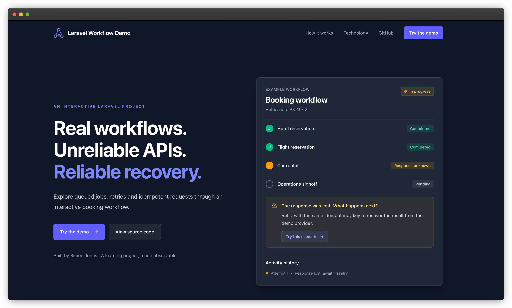
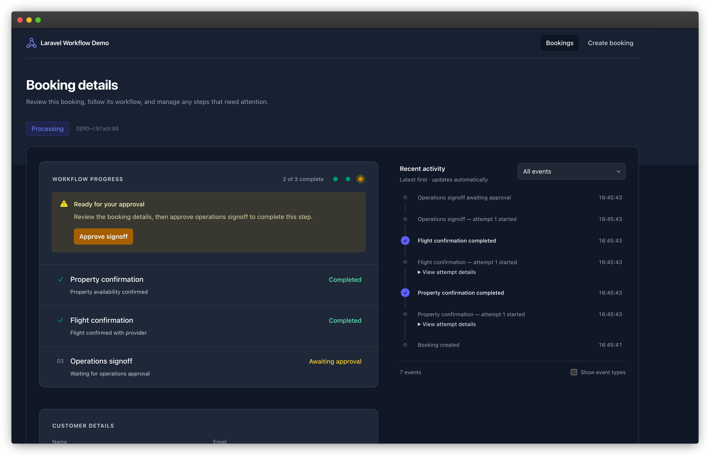

# Laravel workflow demo

A hands-on demo of Laravel queues using travel bookings. Watch booking steps update live, try failures and retries, and approve bookings that need a final signoff.

Built with Laravel 13 and Livewire 4. Requires PHP 8.4 or later.



## What you can explore

- **Background processing** — queue jobs request confirmations for individual booking steps.
- **Workflow dependencies** — steps wait for other steps to finish.
- **Live progress** — booking status and activity update automatically.
- **Retries and recovery** — watch automatic retries, retry failed steps yourself, and pick up pending work.
- **Human approval** — optionally require operations signoff before the booking completes.
- **Provider responses** — expand activity entries to see requests and responses.
- **Lost responses** — see how a retry retrieves a confirmation when the first response goes missing.

The providers are simulated inside the application. No real travel reservations or payments are made.

## Quick start

You’ll need PHP 8.4 or later with SQLite support, Composer, and a Node.js/npm version supported by the project’s dependencies. Serve the app with Laravel Herd or PHP’s development server.

From a fresh checkout:

```sh
composer install
cp .env.example .env
php artisan key:generate --no-interaction
touch database/database.sqlite
php artisan migrate --no-interaction
npm ci
npm run build
```

Only copy `.env.example` if you do not already have a local `.env`.

Choose a web server option below and set `APP_URL` in `.env` to match. The queue worker also uses this address to call the simulated providers.

Keep these settings:

```dotenv
QUEUE_CONNECTION=database
CACHE_STORE=database
```

Leave `DB_QUEUE_CONNECTION` unset so the queue and bookings use the same database, as this demo expects.

### Serve the website

**With Herd:** link or park the project in Herd and set `APP_URL` to the site's URL. Herd serves the website, so you do not need to run `php artisan serve`.

**Without Herd:** set this in `.env`:

```dotenv
APP_URL=http://127.0.0.1:8000
```

Then start the development server from the project directory:

```sh
PHP_CLI_SERVER_WORKERS=4 php artisan serve --host=127.0.0.1 --port=8000 --tries=1 --no-reload
```

This runs several server workers so slow provider responses don’t block the website. Keep `--no-reload` and restart the server after changing `.env`. If port 8000 is occupied, choose another port and update `APP_URL` to match.

PHP's multiple-worker development server is not supported on native Windows. Use WSL for the command above, or a local web server such as Herd. These server instructions are for local development.

### Run the background processes

With either server option, start a queue worker in a separate terminal:

```sh
php artisan queue:work --queue=default --timeout=60 --no-interaction
```

Start the scheduler in another terminal:

```sh
php artisan schedule:work
```

Leave these processes running while exploring the demo. The worker processes jobs; the scheduler checks for pending work and updates booking statuses every minute. Press Ctrl+C in each terminal to stop its process.

For frontend development, run `npm run dev` instead of rebuilding assets after every change. Restart long-running workers after backend code changes.

## Try a booking

Open `/bookings` at your configured site address, create a booking, then open its details to follow the workflow.



Start with a successful booking, then try the failure and delay controls:

| Try this | What to look for |
| --- | --- |
| Successful booking | Provider steps complete, then the booking waits for operations approval if signoff is enabled. |
| Disable signoff | The booking completes once all provider steps finish. |
| Failing booking with a flight | The flight provider repeatedly fails. Automatic retries eventually leave the step failed. |
| Random failures | Provider attempts may fail, then succeed on a later retry. |
| Simulate network delay | Responses take an additional 1–5 seconds, making progress easier to follow. |
| Simulate lost provider response | The provider completes a booking step, but the application initially records an unknown outcome. A retry retrieves the saved confirmation. |

The deliberately failing flight scenario keeps failing, even if you retry it manually.

### Why the lost-response example matters

A provider can complete a booking step even if the application never receives its response. Retrying could repeat that operation.

The demo gives each request a unique key, called an **idempotency key**, and reuses it on retries. The simulated provider recognises the key and returns the saved confirmation instead of repeating the booking step.

The interface shows only what the application knows, so the outcome stays unknown until a retry retrieves the confirmation. The missing response is simulated.

This depends on provider support: a key only prevents duplicates if the provider honours it.

## How it works

A coordinator queues each step when it is ready. Each step has its own processor, and PHP attributes define which steps must finish first.

The app uses a database queue, Livewire for live updates, and Laravel Telescope for debugging.

## Running tests

```sh
php artisan test --compact
```

## Scope

This is a learning application, not a production booking platform. Payments and cancellation are not implemented.

Once automatic retries are exhausted, failed steps need a manual retry. Operations signoff also requires manual approval.

## License

This project is licensed under the [MIT License](LICENSE).
