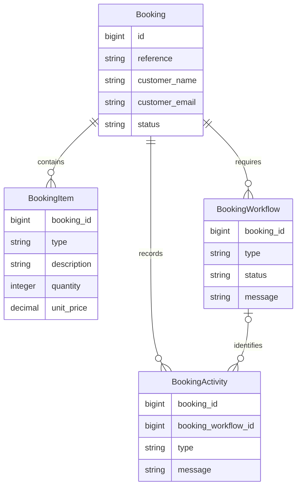
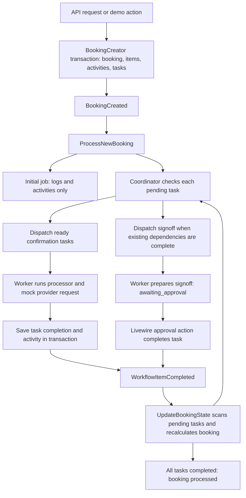

# laravel-worflow-demo: code structure and shared domain language

Updated on 6 October 2026 following the workflow and Livewire changes. This document uses the application name supplied by the owner; the local folder is still `queue-demo`. It describes the current source, with proposed vocabulary and unresolved design decisions labelled separately.

## 1. What this application does

This is a lightweight demonstration of a mini workflow system built with Laravel queues, jobs and workers, using travel bookings as the example domain. It is not intended to be a feature-complete booking application. A booking contains purchased items, such as accommodation and flights. Creating it also creates the tasks required to process it. Background jobs perform provider confirmations and prepare an operations approval. A dashboard shows progress and lets an operator approve or retry a task.

The central business sentence is:

> A booking contains booking items, requires workflow tasks, and records an activity history. Each task must complete before the booking can be marked processed.

The code derives booking state from its tasks and coordinates operations signoff after applicable confirmations. Remaining limitations concern scheduling, repeated execution and state consistency, described below. “Processed” does not mean paid, travelled, or fulfilled: none of those concepts is modelled.

## 2. Shared vocabulary

Use these terms in conversations, tickets and future documentation. These are proposed common names for existing concepts, not class renames applied to the application.

| Preferred term | Meaning in this application | Code or storage representation |
| --- | --- | --- |
| **Booking** | The central record of a customer's requested travel items and their processing progress. | `Booking`; `bookings` |
| **Booking reference** | The unique business-facing identifier for a booking. Distinct from the numeric database ID. | `Booking.reference` |
| **Customer details** | The name and email captured on a booking. There is no separate customer entity. | `customer_name`, `customer_email` |
| **Booking item** | A priced line describing something included in a booking. | `BookingItem`; `booking_items` |
| **Item type** | The category used to decide which confirmation task is required. | `BookingItem.type`: `accommodation`, `flight`, `car_hire` are recognised by the factory |
| **Booking total** | The sum of quantity × unit price for every item. Calculated rather than stored. | `Booking::total()` |
| **Booking process** | The overall journey from booking creation through confirmation tasks and operations approval. | Distributed across services, events, listeners and jobs; no single process entity |
| **Workflow task** | One tracked requirement belonging to a booking, with its own type, status and message. The UI calls these “Child workflows”. | `BookingWorkflow`; `booking_workflows` |
| **Task type** | The kind of work required, used to choose a processor. | `BookingWorkflow.type` |
| **Property confirmation** | The task that requests confirmation for accommodation. | `property_confirmation` |
| **Flight confirmation** | The task that requests flight confirmation. | `flight_confirmation` |
| **Vehicle confirmation** | The task that requests confirmation for car hire; its processor, client and mock endpoint are implemented. | `vehicle_confirmation` |
| **Operations signoff** | A task whose preparation waits for applicable confirmation tasks to complete, then waits for human approval. | `operations_signoff` |
| **Provider** | A service asked to confirm a booking. Current integrations call mock endpoints inside this same application. | `PropertyProviderClient`, `FlightProviderClient`, `VehicleProviderClient` |
| **Provider reference** | The confirmation identifier returned by a mock provider. Stored inside the task message, not in a dedicated field. | Response `provider_reference` |
| **Processor** | The implementation that performs one type of workflow task. | Implementations of `WorkflowProcessor` |
| **Workflow coordinator** | Decides whether a pending task can be dispatched by inspecting its processor’s declared dependencies. | `WorkflowCoordinator::startIfReady()` |
| **Dependency** | A task type whose existing tasks on the same booking must be completed before a dependent task is dispatched. Absent types are ignored. | `DependsOn` attribute |
| **Queue worker** | The process that consumes queued jobs and executes their attempts. It is separate from the Livewire interface. | Laravel queue worker |
| **Livewire component** | Server-side UI state and actions, refreshed by polling. It displays workflow progress; it does not execute the background queue. | `DashboardBookings`, `BookingDetail` |
| **Processing attempt** | One execution of a queued job. An attempt can fail and be tried again. | Queue attempt count; activity messages |
| **Automatic retry** | Another queue attempt after an exception, within the job's retry limit. | Both jobs declare `tries = 3`, `backoff = 5` seconds |
| **Manual retry** | An operator resets a failed task to pending and dispatches a new job for it. | `BookingDetail::retryWorkflow()` |
| **Activity entry** | A timestamped, human-readable record belonging to a booking and optionally to a particular workflow task. | `BookingActivity`; `booking_activities` |
| **Domain event** | A signal that causes another part of the application to react. It is separate from a stored activity entry. | `BookingCreated`, `WorkflowItemCompleted` |
| **Queue job** | A technical unit of background execution. A job executes work; the workflow task stores its business progress. | `ProcessBookingJob`, `ProcessBookingWorkflowJob` |
| **Operator** | The person using approval and retry controls. This is a conceptual actor, not a modelled role. | Dashboard actions; no operator relationship or approval identity |
| **User** | The framework authentication account model. It is not linked to booking customers or approvals. | `User`; `users` |

### Language rules that prevent ambiguity

- Say **“the flight confirmation task failed”** when a `BookingWorkflow` failed. The terminal failure handler also recalculates the booking as `failed`. A failed attempt that will be retried is not yet a terminal task failure.
- Say **“the task completed”** for task status `completed`; say **“the booking was processed”** for booking status `processed`.
- Use **booking item** for a purchased line and **workflow task** for required work. Despite its name, `WorkflowItemCompleted` carries a `BookingWorkflow`, not a `BookingItem`.
- Use **operations signoff** for the approval decision. Provider confirmation and human approval are different actions.
- Qualify “retry” as **automatic retry** or **manual retry**.
- Distinguish **pending**, **queued** and **running** when discussing execution. The current task status `pending` covers both waiting for dependencies and already dispatched jobs; there is no separate `queued` status.
- Treat the **initial booking job** as a logging/activity demonstration. It no longer calls a supplier or controls booking status.

## 3. Main domain objects and relationships



All four tables have their own IDs and creation/update timestamps. Child records cascade on booking deletion. An activity’s optional workflow link is set to null if that workflow is deleted. The database permits a booking without items; the API requires at least one.

**Booking** is the organising object for understanding the domain. Its [model](app/Models/Booking.php) exposes `items()`, `workflows()` and `activities()`, casts its status to [BookingStatus](app/Enums/BookingStatus.php), and calculates its total. It is reasonable to discuss it as the domain's central aggregate, although the current code also changes child records directly through Livewire actions and jobs.

**BookingItem** describes purchased content. Quantity and price are stored, but there are no dates, passengers, property IDs, flight IDs, tax calculations or currency field. The UI displays pounds; the model does not define a money value object or currency conversion.

**BookingWorkflow** stores a task's current state. It belongs directly to the booking, not to a particular item. The [factory](app/Services/Workflows/BookingWorkflowFactory.php) uses `firstOrCreate` by type within a booking: two flight items normally produce one flight confirmation task. There is no database unique constraint on `(booking_id, type)` to enforce that intent under concurrent creation.

**BookingActivity** is a timeline entry with a type and message. It is not an event-sourced source of truth: current state lives in booking and workflow records, and the application does not rebuild that state from activities. The nullable `booking_workflow_id` links task-specific entries to their workflow. Booking-wide entries have no task link. Livewire uses this relationship to filter the timeline; older entries without a link remain visible only in the full booking history.

The [migrations](database/migrations) are the schema source. Item type is nullable in the schema, although the creation API requires a string.

## 4. Code structure

| Location | Responsibility and useful starting points |
| --- | --- |
| [app/Models](app/Models) | Persistent domain records and their relationships. Start with `Booking.php`. |
| [app/Enums](app/Enums) | The four booking statuses. Workflow statuses and types are currently plain strings. |
| [app/Http/Requests](app/Http/Requests) | `StoreBookingRequest` validates API input, including a unique reference and at least one item. |
| [app/Http/Controllers](app/Http/Controllers) | API creation, page entry points, demo booking creation and mock provider responses. Approval and retry now live in Livewire. |
| [app/Services/BookingCreator.php](app/Services/BookingCreator.php) | Creates a booking, its items, initial activity and workflow tasks in one database transaction. Shared by API and demo creation. |
| [app/Services/BookingStateService.php](app/Services/BookingStateService.php) | Derives failed, processing or processed status from task states. |
| [app/Services/Workflows](app/Services/Workflows) | Task factory, dependency coordinator, processor contract, resolver and four processor implementations. |
| [app/Attributes/HandlesWorkflow.php](app/Attributes/HandlesWorkflow.php) | Attribute declaring which task type a processor handles. |
| [app/Attributes/DependsOn.php](app/Attributes/DependsOn.php) | Declares prerequisite task types on a processor. |
| [app/Livewire](app/Livewire) | `DashboardBookings` renders counts and rows; `BookingDetail` renders tasks/history and handles selection, approval and retry. |
| [app/Services/Providers](app/Services/Providers) | HTTP clients for property, flight and vehicle confirmation. |
| [app/Events](app/Events) and [app/Listeners](app/Listeners) | Connect creation to scheduling, and completion to further scheduling plus booking-state recalculation. |
| [app/Jobs](app/Jobs) | Initial booking processing and individual task execution, with retry/failure handling. |
| [routes/web.php](routes/web.php), [routes/api.php](routes/api.php) | Public entry points into the demo. |
| [resources/views](resources/views) | Blade page wrappers, Livewire templates and reusable booking rows. `wire:poll` replaces custom polling JavaScript; `resources/js/app.js` is effectively empty. |
| [database](database) | Migrations, starter user factory/seeder and a local SQLite file. |
| [config](config), [bootstrap](bootstrap) | Runtime configuration, application bootstrapping and provider registration. Queue configuration defaults to the database driver, subject to environment overrides. |
| [tests](tests) | Starter PHPUnit tests. No substantive booking workflow coverage currently exists. |
| `public`, `storage` | Web entry/assets and runtime files respectively. |
| `vendor`, `node_modules` | Installed dependencies, rather than application domain code. |

The installed framework inspected was Laravel 13.34.0 on PHP 8.5.2. Livewire 4.4.7 is installed. Composer also includes Sanctum and Telescope. Frontend build dependencies include Vite and Tailwind. Their presence does not make them domain objects.

## 5. How a booking moves through the application



1. **Accept and create.** [BookingController](app/Http/Controllers/BookingController.php) validates API input; [DemoBookingController](app/Http/Controllers/DemoBookingController.php) supplies example data. Both call [BookingCreator](app/Services/BookingCreator.php), which persists the pending booking, items, initial activity and tasks in a transaction, then emits `BookingCreated` after that transaction call returns.
2. **Schedule ready work.** [ProcessNewBooking](app/Listeners/ProcessNewBooking.php) dispatches the initial booking job and passes every created task to [WorkflowCoordinator](app/Services/Workflows/WorkflowCoordinator.php). The coordinator resolves the processor, inspects `DependsOn`, and dispatches a pending task if none of its existing dependencies are incomplete. Dispatch itself leaves the task pending.
3. **Keep initial processing separate.** [ProcessBookingJob](app/Jobs/ProcessBookingJob.php) records logs and booking-wide activities. It does not change booking status, call a supplier, or act as a prerequisite for confirmation tasks. The earlier `BK034` supplier-failure simulation is gone.
4. **Execute queued tasks.** [ProcessBookingWorkflowJob](app/Jobs/ProcessBookingWorkflowJob.php) skips processor execution if the task is already completed, but re-emits its completion event to reconcile scheduling and parent state. Otherwise it records an attempt and invokes the processor. Exceptions produce `workflow_attempt_failed` activity and are rethrown for queue retry handling. Terminal failure marks the task failed and recalculates the booking.
5. **Confirm or wait.** Property, flight and vehicle processors call their mock provider clients, then transactionally save completion and its activity before emitting `WorkflowItemCompleted`. Operations signoff transactionally records preparation and changes to `awaiting_approval`; this does not complete the task or emit a completion event.
6. **Release dependent work.** [UpdateBookingState](app/Listeners/UpdateBookingState.php) responds to completion by loading the booking’s tasks, asking the coordinator to start ready tasks, then recalculating booking state. Operations declares property, flight and vehicle confirmation dependencies. Only matching tasks actually present on that booking are checked: a booking without car hire does not wait for vehicle confirmation. These are independent jobs coordinated through stored task state, not a Laravel job chain or batch.
7. **Approve or retry through Livewire.** [BookingDetail](app/Livewire/BookingDetail.php) completes an awaiting-approval task and emits the completion event. Manual retry resets a failed task to pending, adds activity, recalculates the booking and directly dispatches a workflow job. This retry path does not call the dependency coordinator.
8. **Refresh the interface.** [DashboardBookings](app/Livewire/DashboardBookings.php) polls every two seconds. Booking detail polls every second, refreshes the booking and loads items, tasks and activity. Selecting a task shows its linked activities; “Show all activity” restores the full history. `wire:click.stop` prevents approval/retry clicks also selecting the task card. Queue workers perform the work independently of these UI requests.

The resolver uses an explicit list of four processor classes and their `HandlesWorkflow` attributes. Adding a processor still requires registration in that list; the attribute alone does not provide automatic discovery.

## 6. State language and transition rules

### Booking status

| Status | Exact current meaning / writer |
| --- | --- |
| `pending` | Initial creation status. Currently can persist while tasks run, until a recalculation occurs. |
| `processing` | State service found no failed tasks and at least one incomplete task, including tasks awaiting approval. |
| `processed` | Written by the state service when every workflow task is completed. |
| `failed` | State service found at least one failed workflow task. This takes precedence over incomplete/completed checks. |

Recalculation currently occurs on task completion, terminal task failure and manual retry. It does not run when a processor first starts, so booking status can temporarily lag task progress. The initial booking job no longer writes status.

### Workflow task status

| Transition | Trigger |
| --- | --- |
| `pending` → `processing` | A registered processor starts the task. |
| `processing` → `completed` | Property, flight or vehicle confirmation succeeds. |
| `processing` → `awaiting_approval` | Operations signoff preparation finishes. |
| `awaiting_approval` → `completed` | Livewire approval action. |
| Any existing task state → `failed` | The workflow job's terminal failure handler runs. A resolver failure can occur before `processing` is written. |
| `failed` → `pending` | Manual retry action resets the existing task and dispatches a new job. |

During automatic retries, a task may remain `processing` until another attempt succeeds or the job finally fails. Both jobs specify three total attempts with five-second backoff. Manual retry starts another job with that policy; it does not create a new workflow record.

### Item-to-task rules

| Item type | Task created | Current execution support |
| --- | --- | --- |
| `accommodation` | `property_confirmation` | Dispatched and implemented |
| `flight` | `flight_confirmation` | Dispatched and implemented |
| `car_hire` | `vehicle_confirmation` | Dispatched and implemented |
| Any other string | No item-specific task | Accepted by API validation; silently skipped by factory |
| Every booking | `operations_signoff` | Always created; dispatched after existing confirmation dependencies complete, then requires manual approval |

## 7. Entry points and demo scenarios

| Method and path | Purpose |
| --- | --- |
| `GET /` | Dashboard with booking status counts and totals |
| `GET /bookings/{booking}` | Booking detail, tasks and activity history |
| `POST /api/bookings` | Create a booking from validated input |
| `GET /api/bookings/statuses` | List booking IDs, references and statuses |
| `POST /demo/bookings/successful` | Create a booking with accommodation and flights expected to confirm |
| `POST /demo/bookings/failing` | Create a booking whose flight confirmation always returns HTTP 503 |
| `POST /demo/bookings/random-failure` | Create a booking whose flight confirmation randomly returns HTTP 503 |
| `POST /api/demo/providers/property/confirm` | Mock property confirmation |
| `POST /api/demo/providers/flights/confirm` | Mock flight confirmation |
| `POST /api/demo/providers/vehicles/confirm` | Mock vehicle confirmation |

Routes were confirmed with `php artisan route:list --except-vendor`. Framework/package routes, including Livewire’s update endpoint, are outside this table. The former custom polling, approval and retry routes have been removed; polling and actions now use Livewire.

The successful demo has one accommodation item at £1,200 and two flights at £350 each, totalling £1,900. After confirmations complete, it still needs operations approval before the booking becomes processed. All three demo buttons currently create accommodation and flight items; vehicle confirmation is available through a `car_hire` item in the creation API. References containing `FAILR` trigger a fresh 50% flight failure decision per request; other references containing `FAIL` always fail flight confirmation. Retrying the deterministic failure does not change that condition.

Provider clients send only `booking_reference`; these endpoints do not reserve real inventory or validate item availability. The clients check HTTP failure and consume the returned reference, without a separate business-status or response-schema check.

## 8. Remaining limitations relevant to a lightweight demo

The aim is to make workflow execution understandable, not to build a complete travel platform. Mock providers, simple customer details, fixed currency display and the absence of a full user-role system are deliberate scope choices rather than missing demo features.

The earlier review’s conflicting booking-state writers, missing vehicle processor, duplicated creation logic and lack of dependency coordination have been addressed. The completed-task guard and transactional provider completion also improve repeat execution. The following issues remain:

| Finding | Observable effect | Smallest useful direction |
| --- | --- | --- |
| **Already queued tasks remain pending.** The coordinator checks pending status but does not claim a task when dispatching. | Completing property confirmation before the queued flight job starts queues a second flight job. Completion events can also queue duplicate signoff jobs. | Distinguish dependency-waiting from queued work, make dispatch eligibility an atomic transition, and prevent overlapping execution of the same task. |
| **Completed-task checks do not prevent concurrent execution.** Two jobs can both start before either completes; awaiting-approval tasks are not skipped. | Duplicate provider requests or repeated signoff preparation remain possible. | Keep the completed-task reconciliation path, while protecting execution from overlap and defining which states may execute. |
| **Livewire mutation actions use a global task lookup.** Approval and retry call `BookingWorkflow::findOrFail`; task selection correctly checks the current booking. | An action on booking A’s component can be passed booking B’s task ID and change B. | Resolve mutations through `$this->booking->workflows()`; retain status checks and check signoff type for approval. |
| **Booking status is not recalculated when work starts.** | A running first task can still appear under a pending booking until completion or terminal failure. | Recalculate through the state service at the start of processing. |
| **Approval completion is not atomic or recoverable through repeat approval.** Task update, activity and event are separate; an already completed task returns immediately. | An interruption after completing the task can leave its parent state stale and remove the approval control. | Save approval and activity together, and make repeated completion safely reconcile parent state. |
| **The existing tests do not exercise workflow behaviour.** The dashboard test lacks database migration setup. | The current suite fails before proving dashboard behaviour; scheduling and Livewire boundaries are untested. | Fix test database setup and add focused tests for dependencies, duplicate scheduling, failure/retry, approval and booking-scoped actions. |

There are two smaller design details to explain when teaching the demo. First, `DependsOn` means “wait for these task types if present”, rather than “require all listed types to exist”. Second, manual retry directly dispatches its job, bypassing the coordinator; this should be revisited if dependencies become more complex or completed prerequisites can be reset.

The dashboard controller also still queries bookings and counts which its Livewire component queries again. Removing that duplicate read is a straightforward cleanup, not a workflow redesign.

Unknown item types are still accepted and skipped by the factory. The factory normally creates one task per type per booking, and always adds signoff. Those are the current demo rules; neither a general workflow-definition editor nor per-item orchestration is implied.

## 9. A compact language for requirements

This notation is a documentation convention, not an executable DSL:

```text
Booking
  identified by Booking Reference
  captures Customer Details
  contains one or more Booking Items at API creation
  requires Workflow Tasks
  records Activity Entries

Booking Item
  has Item Type, Description, Quantity and Unit Price
  contributes Quantity × Unit Price to Booking Total

Workflow Task
  belongs to one Booking
  has Task Type, Task Status and Current Message
  is executed by a matching Processor through a Queue Job
  may require a Provider Confirmation or Operations Signoff
  may depend on other Task Types present on the same Booking

Workflow Coordinator
  dispatches pending tasks whose existing dependencies are complete

Task Completed
  triggers scheduling of ready tasks and recalculation of Booking Status

Task Failed after its final attempt
  triggers recalculation of Booking Status to Failed

All Workflow Tasks Completed
  allows Booking Status to become Processed
```

Examples for tickets and conversations:

- “When a booking includes a flight item, create one flight confirmation task for that booking.”
- “When flight confirmation exhausts its automatic attempts, mark that task failed, record an activity entry and recalculate the booking as failed.”
- “An operator may manually retry a failed task; the task returns to pending.”
- “Prepare operations signoff only after all confirmation tasks present on the booking have completed.”
- “When operations signoff is approved, complete that task and recalculate the booking status.”

The main teaching distinction is that a **task is durable business state**, a **job is an execution attempt**, a **worker runs the job**, the **coordinator decides readiness**, and **Livewire displays state and accepts human actions**. A job finishing does not necessarily complete its task: signoff preparation finishes while the task waits for approval.

## 10. Suggested reading order and verification scope

Read [Booking](app/Models/Booking.php), [BookingWorkflowFactory](app/Services/Workflows/BookingWorkflowFactory.php), [BookingCreator](app/Services/BookingCreator.php), [ProcessNewBooking](app/Listeners/ProcessNewBooking.php), [WorkflowCoordinator](app/Services/Workflows/WorkflowCoordinator.php), [ProcessBookingWorkflowJob](app/Jobs/ProcessBookingWorkflowJob.php), [WorkflowProcessorResolver](app/Services/Workflows/WorkflowProcessorResolver.php), the processors, [UpdateBookingState](app/Listeners/UpdateBookingState.php), [BookingStateService](app/Services/BookingStateService.php), then [BookingDetail](app/Livewire/BookingDetail.php) and [DashboardBookings](app/Livewire/DashboardBookings.php).

The 6 October reassessment checked application source, migrations, views, routes and installed Livewire version. Isolated reproductions used an in-memory SQLite database and intercepted queue dispatches. They confirmed:

- Flight jobs increased from one to two after property completion while flight remained pending.
- Booking status remained pending when its first task was moved to processing.
- A Livewire component mounted for booking A could approve an awaiting-approval task belonging to booking B.

`php artisan test --compact` reported one pass and one failure. The dashboard test returned 500 because its in-memory database lacked the `bookings` table. The separate `TestJob.php` file is a dashboard example and was not included in that default run.

These checks did not exercise real workers, real provider HTTP requests or browser interactions. Review records were confined to the temporary in-memory database. This guide update changes documentation only; the limitations above remain findings, not implemented fixes.
